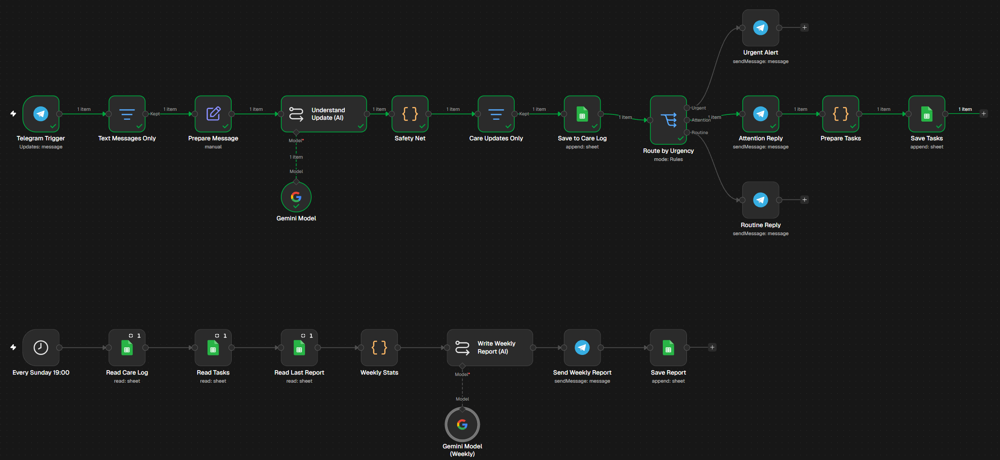
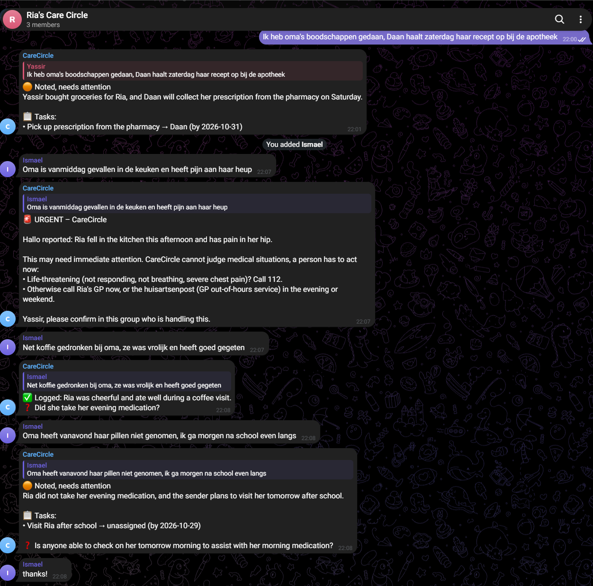
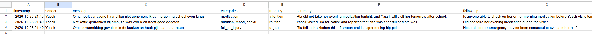
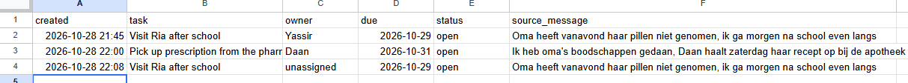
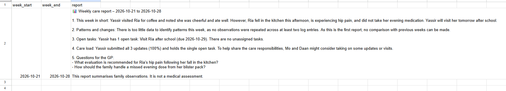

# CareCircle: a shared care log for families caring at home (n8n)

CareCircle turns the everyday messages a family sends about an older relative into a shared care log, assigned tasks, urgent alerts and a weekly care report. Family members simply write in a Telegram group, in Dutch or English, the way they already do. An AI model understands each message; code checks the AI and decides what happens next.

**Team:** Haki Abdulovski (23177314) and Yassir Balah (26095270) · **Course:** AI for Good, Hackathon 2 (redo) · **SDG 3: Good Health & Well-being**

## What changed since the first attempt

Our first Hackathon 2 project, AirCalm ([`Term 1/Week 2/hackathon`](../../../../Term%201/Week%202/hackathon)), did not meet knock-outs **K1 (AI tool)** and **K3 (scope)**: the AI only rewrote air-quality numbers into sentences, and the result was no better than searching "air quality today". For this redo we started from zero with a new idea and used two tests for every design choice: *could Google give the same answer?* and *could a fixed template replace the AI?* For CareCircle the answer to both is no.

| | First attempt: AirCalm | Redo: CareCircle |
|---|---|---|
| **K1: AI** | Rewrote numbers into text; a template could replace it | Reads free text, decides urgency and route, extracts tasks with owners, finds weekly patterns |
| **K3: Scope** | One public data source, one message | Private family observations, memory over weeks, real actions (log, tasks, alerts, report) |
| **Flow** | 1 trigger, 9 nodes | 2 triggers, 23 nodes, 3 urgency routes, code safety net |

**Files in this folder:** [`workflow/CareCircle.json`](workflow/CareCircle.json) (n8n export) · [`presentation/CareCircle_slides.pdf`](presentation/CareCircle_slides.pdf) (slides) · [`ETHICAL_REFLECTION.md`](ETHICAL_REFLECTION.md) · [`screenshots/`](screenshots/)

## The problem

In the Netherlands about 5.5 million people give informal care, and about 600,000 of them felt seriously burdened in 2024 ([SCP via NOS](https://nos.nl/l/2615198)). Around 300,000 people live with dementia, cared for by an estimated 800,000 relatives and friends ([Alzheimer Nederland / Nivel](https://skipr.nl/nieuws/in-grote-steden-zijn-mantelzorgers-rond-dementie-het-vaakst-overbelast)). When several relatives share this care, information gets lost in a busy group chat: a missed dose, a fall that "seemed fine", a task nobody picked up. Often one person ends up carrying almost everything.

CareCircle works on the family's own private observations. No search engine has that information, and no fixed template can read it.

## Who it is for

Families and friends who share the care of an older relative living at home, for example someone with early-stage dementia. The demo uses a fictional case: **Ria (82)**, cared for by Yassir (coordinator), Mo and Daan.

## What it does

**Flow 1: every message (Telegram trigger, real time)**
1. A family member posts an update in the group, e.g. *"Oma heeft vanavond haar pillen niet genomen, ik ga morgen na school even langs."* (Dutch for: "Grandma didn't take her pills tonight, I'll drop by tomorrow after school.")
2. **AI** reads the free text and returns structured data: care categories, urgency (`urgent` / `attention` / `routine`), a one-sentence English summary, tasks with an owner and due date, and a follow-up question if important information is missing. It also decides whether the message is a care update at all ("thanks!" is ignored).
3. **Safety net (code)** checks the AI: red-flag words such as *fell / gevallen (fallen) / benauwd (short of breath) / chest pain* always escalate to `urgent`, whatever the AI said. Unreadable AI output is sent to a human as `attention`.
4. Every care update is saved in the **care log** (Google Sheets) and routed by urgency:
   - 🚨 **Urgent:** a fixed alert (not AI-written) tells the family to call 112 or the GP and asks the coordinator to confirm who is handling it.
   - 🟠 **Attention:** reply with the tasks and owners; tasks are saved to the **task list**.
   - ✅ **Routine:** short confirmation.

**Flow 2: weekly care report (every Sunday 19:00)**
Code reads the care log, open tasks and last week's report, and counts updates per category, urgency and person. **AI** then writes the report: the week in short, patterns backed by at least two entries, open tasks, how the care load is spread over the family, and neutral questions to bring to the GP. The report is posted in the group and saved, so next week's report can compare.

## Why AI is essential here

Without the AI nodes nothing works: no rule set can read "mam was vanmiddag de weg kwijt bij de Albert Heijn, Mo haalt morgen haar recept op" ("mum got lost at the supermarket this afternoon, Mo will pick up her prescription tomorrow") and turn it into a cognition concern plus a task for Mo, or find a pattern across a week of messages. The division of work is deliberate: **AI interprets language, code guards safety and decides escalation, people make every medical decision.**

## SDG 3: why

- **Target 3.4 (mental health and well-being):** caregiver overload is a real health risk. CareCircle spreads tasks, makes the load visible and gently flags when one person does most of the work.
- **Target 3.8 (access to quality care):** older people at home get earlier attention when something changes, and the family arrives at the GP with structured observations instead of scattered memories.

## How to run it

1. **Telegram:** create a bot with @BotFather, run `/setprivacy` → *Disable*, create a group and add the bot.
2. **Google Sheets:** create a spreadsheet with three tabs and these headers in row 1:
   - `Log`: timestamp, sender, message, categories, urgency, summary, follow_up, safety_override, chat_id
   - `Tasks`: created, task, owner, due, status, source_message
   - `Reports`: week_start, week_end, report
3. **Gemini:** create a free API key at aistudio.google.com.
4. **n8n:** *Import from File* → `workflow/CareCircle.json`. Add the Telegram credential to the five Telegram nodes, the Gemini credential to both Gemini Model nodes (choose a current *Flash* model), and the Google Sheets credential to the six Sheets nodes (select your spreadsheet and the right tab).
5. Adapt the care profile and team names in **Prepare Message** and **Write Weekly Report (AI)**.
6. Click **Publish**. From then on every message in the group is processed, and the report arrives every Sunday at 19:00. Tasks are closed by setting `status` to `done` in the sheet.

## Limitations

The AI can misread a message; the red-flag list cannot catch every emergency. CareCircle is a coordination tool, **not** an emergency or medical service. It does not diagnose or give medication advice. See **[ETHICAL_REFLECTION.md](ETHICAL_REFLECTION.md)**.

## Demo

Tested live on 28 October 2026 with the workflow published in n8n Cloud.

**The Telegram group:** an attention reply with a task, an urgent alert after a fall, a routine confirmation, and "thanks!" ignored.

**The care log and task list in Google Sheets:**

**The weekly care report** (generated by the AI from the log, then saved for next week's comparison):

